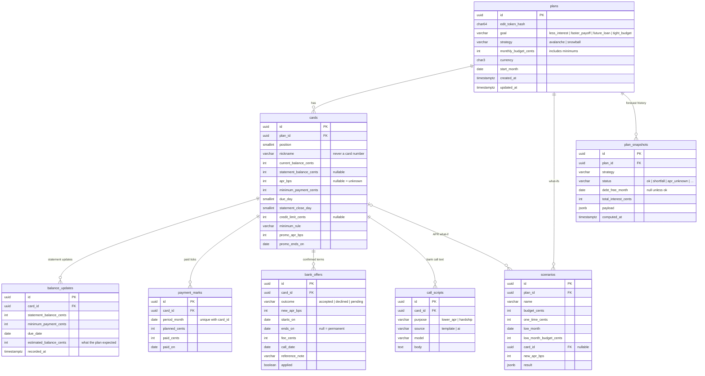

# Database schema

Source of truth: [`backend/db/schema.sql`](../backend/db/schema.sql) (PostgreSQL) and
[`backend/app/models.py`](../backend/app/models.py) (ORM, also runs on SQLite for local work).

## Rules

- **No personal data.** There is no users table. A plan is anonymous and is opened with an
  edit token that is shown once; only its SHA-256 hash is stored.
- **Money is integer cents, rates are basis points** (29.00% = 2900). Nothing is rounded in storage.
- **Saving is optional.** `POST /api/plan/calculate` stores nothing. Rows exist only if the
  person chooses to save.
- **Deleting a plan deletes everything under it** (`ON DELETE CASCADE`).
- **Unknown stays unknown.** `apr_bps` and `credit_limit_cents` are nullable on purpose: a
  missing APR means no interest forecast, a missing limit means no limit-use figure.

## Diagram

## Which screen writes which table

| Screen | Table |
|---|---|
| Setup: goal, budget | `plans` |
| Setup: add cards | `cards` |
| Plan, 90 days, Forecast | `plan_snapshots` (cache only; always recomputable) |
| Update balances | `balance_updates`, `payment_marks` |
| What if | `scenarios` |
| Bank call: script | `call_scripts` |
| Bank call: enter the offer | `bank_offers`, then `cards.apr_bps` when applied |
| Your data: delete | deletes the `plans` row and everything under it |

## Not in the schema yet

These belong to the extended concept, outside the hackathon scope: other debts and regular
bills (hub), paydays and a checking balance (bills shield), the Credit Health Index, and
refinance offers.
